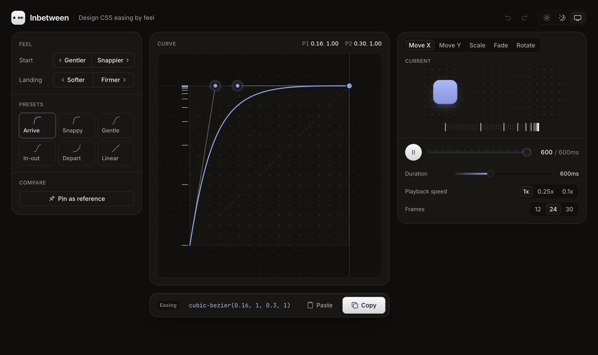

# Inbetween

Design CSS easing by feel.



Inbetween is a small editor for `cubic-bezier()` timing functions. You can drag the curve handles, grab the curve itself to bend it, or nudge the feel with plain words like *Gentler*, *Quicker* and *Softer*. The preview plays the motion, and a spacing ruler shows where each frame lands, the way an animator spaces inbetweens. When it feels right, copy the CSS.

- Six presets named for when to use them, each with a suggested duration
- Feel nudges for the whole motion, the start and the landing, previewed on hover
- Live preview of Move, Scale, Resize, Fade and Rotate, with a scrubber and slow-motion playback
- Frame-spacing rulers at 12, 24 or 30 frames per second, plus an onion skin that outlines every frame
- Pin a curve as a reference to compare against it
- Output as CSS, a full `transition:` line, Tailwind, Motion or SwiftUI; the code line shows exactly what Copy copies
- Right-click the curve to reverse it, pin it, copy it, or undo
- Paste any `cubic-bezier()` to import it. The arrow keys nudge the number under the cursor.
- Undo and redo (⌘Z / ⇧⌘Z), Space to play or pause, ← / → to step a frame, 0 to jump to frame 0, ⌥1–⌥5 to switch the preview, and light, dark or system theme

## Run

```bash
pnpm install
pnpm dev
```

Built with React, TypeScript, Vite and Motion.
